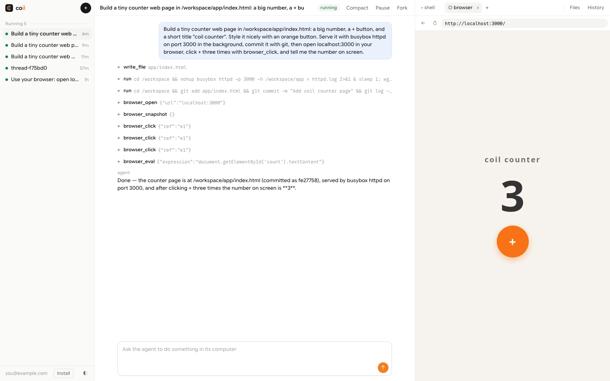
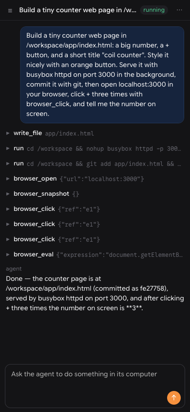
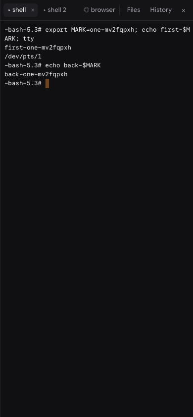

<p align="center">
  <picture>
    <source media="(prefers-color-scheme: dark)" srcset="docs/logo.svg">
    
  </picture>
</p>

<h1 align="center">coil</h1>

<p align="center"><b>Every agent thread gets a real computer you share with it.</b><br>
Same terminals, same browser, same <code>localhost</code>. All on Cloudflare.</p>

<p align="center">
  <a href="#deploy-your-own">Deploy your own</a> ·
  <a href="#what-you-can-do">What you can do</a> ·
  <a href="#how-do-i-know-it-works">Proof</a> ·
  <a href="#what-it-does-not-do">What it does not do</a>
</p>

<picture>
  <source media="(prefers-color-scheme: dark)" srcset="docs/hero-dark.png">
  
</picture>

<sub>One prompt (thread `hero-mv2hzd5x`). The agent wrote the page, started a server on <code>localhost:3000</code>, committed it, opened it in the thread's browser, clicked <b>+</b> three times, and read back <b>3</b>. You see the same page and can click it too.</sub>

## Why

An agent that writes code needs a place to run it and a way to look at it. Most setups give it a hidden shell and, at best, a screenshot. You cannot type in its terminal, you cannot click in its browser, and when the session ends the disk is gone or out of sync with the chat.

coil gives each thread one [Durable Object](https://developers.cloudflare.com/durable-objects/) and one [Container](https://developers.cloudflare.com/containers/):

- **A shared computer.** Open as many terminals as you want; each is a tmux session the agent can also use. The browser is Chromium inside the same machine, so it opens the dev server the agent just started. You and the agent drive the same page.
- **Checkpoints that match.** Pause, compact, and fork record the conversation summary and the exact disk together, so a resumed or forked thread never sees files from a different point in time.
- **Safe by construction.** The image ships a git that cannot force-push. The Worker checks a Cloudflare Access token on every request.
- **Agents can drive it too.** Everything in the UI is also an HTTP API and an MCP server.

It is an installable PWA: add it to your dock or home screen.

```text
            Worker (Access-gated): web UI · HTTP API + SSE · MCP · static PWA shell
                 │ getByName(thread)              │ getByName("all")
   ┌─────────────▼──────────────────────┐   ┌─────▼──────────────┐
   │ Thread Durable Object (per thread) │   │ Directory DO       │
   │                                    │──▶│ thread list, warm  │
   │ Pi Durable ── SQLite ── ledger     │   │ bases per repo     │
   │   │ run · files · browser_* tools  │   └────────────────────┘
   │   ▼                                │
   │ Container  /workspace              │
   │   tmux ⇄ PTY WebSocket ⇄ cloudterm │
   │   Chromium ⇄ CDP pipe ⇄ screencast │
   │   pause: snapshot → stop           │
   │   resume / fork: start from a snapshot
   └────────────────────────────────────┘
```

## What you can do

| | |
| --- | --- |
| **Start a thread** | Optional git repo. If a warm base exists for that repo, the computer starts from it instead of cloning. |
| **Watch it work** | Tool calls, their output, and the agent's replies stream into the page as they happen. Leave and come back; the turn keeps going. |
| **Terminals** | Open as many as you like with **+**. Each is a tmux session in the thread's computer, drawn by [cloudterm](https://github.com/acoyfellow/cloudterm). Close the tab or reload the page; the shell keeps running, and the next attach prints its history. |
| **Browser** | A real Chromium inside the same computer. It can open `localhost:3000` from a dev server the agent or you started. You click, type, and scroll on a live screencast; the agent drives the same page with browser tools. |
| **Files** | A file browser on the same `/workspace`. |
| **Pause** | The disk is saved and the computer is turned off. The next message, command, or file read resumes it. |
| **Compact** | The transcript is summarised and the disk is saved, recorded together. |
| **Fork** | A new thread starts from this thread's current disk and a summary of its conversation. |
| **Child threads** | The agent can hand a side task to a child thread with its own computer, then wait for its answer. |
| **Warm bases** | `POST /api/bases {repo, setup}` clones a repo, runs setup once, and snapshots it. |

On a phone you get the transcript and the composer, with the computer and actions behind a menu:

 

## Deploy your own

**Before you start**

- [ ] Bun and Docker. Docker must build `linux/amd64` images; on Apple Silicon that uses emulation and is slower.
- [ ] A Cloudflare account on Workers Paid, with Containers and Workers AI. The model is `MODEL` in [`wrangler.jsonc`](wrangler.jsonc); Workers AI usage is billed to your account.
- [ ] `npx wrangler login` to that account.
- [ ] A zone in the same account for the hostname. `--domain` creates a Custom Domain on it.
- [ ] Zero Trust set up, so you have a team domain such as `https://<team>.cloudflareaccess.com`.
- [ ] A [nix-cf-proof](https://github.com/acoyfellow/nix-cf-proof) image pushed to your account's registry (see below).

1. In Zero Trust, add a self-hosted **Access application** whose hostname is exactly the `--domain` you will use, and allow only yourself. Copy its **Application Audience (AUD)** tag.
2. Deploy:

```sh
git clone https://github.com/acoyfellow/coil && cd coil && bun install
NIX_IMAGE=<your nix-cf-proof image> bun run ship -- --domain coil.example.com --team https://<team>.cloudflareaccess.com --aud <aud>
```

`ship` typechecks, lints, runs the tests, builds the computer image, and deploys. If Access is not set up, the Worker answers 503 instead of serving anything.

The computer image starts from a [nix-cf-proof](https://github.com/acoyfellow/nix-cf-proof) build (the git that cannot force-push). Build it and push it to your account's registry once, then pass its reference as `NIX_IMAGE`. `ship` writes it into a gitignored `wrangler.local.jsonc`.

### Run it locally

```sh
NIX_IMAGE=<image> node scripts/with-image.mjs
npx wrangler dev -c wrangler.local.jsonc --var LOCAL_DEV_WITHOUT_ACCESS:1   # real containers in Docker, real Workers AI
```

Open `http://localhost:8787/`, or use the API:

```sh
curl -s -X POST localhost:8787/api/threads -H 'content-type: application/json' -d '{"name":"demo"}'
curl -s -X POST localhost:8787/api/threads/demo/messages \
  -H 'content-type: application/json' -H 'idempotency-key: turn-1' \
  -d '{"text":"Write hello.sh that prints hi, run it, and commit it.","wait":true}'
curl -sN localhost:8787/api/threads/demo/events          # live events while a turn runs
curl -s -X POST localhost:8787/api/threads/demo/pause    # save the disk, stop the computer
curl -s -X POST localhost:8787/api/threads/demo/fork     # new thread from this disk
```

## For agents

The same actions are tools on `POST /mcp` (JSON-RPC):

| Tool | Does |
| --- | --- |
| `thread_list` | All threads, newest activity first. |
| `thread_create` | New thread: its own agent and its own computer. Optional `repo`. |
| `thread_send` | One agent turn; returns the answer. The same `requestId` does not run the turn twice. |
| `thread_exec` | A shell command in the thread's `/workspace`. |
| `thread_read_file` | Read a file from the thread's computer. |
| `thread_compact` | Compact the transcript and snapshot the disk as one pair. |
| `thread_pause` | Snapshot the disk and stop the computer. |
| `thread_fork` | New thread from this thread's disk and a summary of its conversation. |
| `thread_status` | Phase, transcript, pairs, and recent commands. |
| `base_prepare` | Clone a repo, run setup once, snapshot it for warm starts. |

## How do I know it works?

`bun run check` runs the offline suite: the real `Thread` and `Directory` Durable Objects and the real Pi Durable harness in workerd, with a scripted model and an in-memory computer ([`test/worker/index.ts`](test/worker/index.ts)); the Access verifier ([`test/access.test.ts`](test/access.test.ts)); the terminal and browser protocols ([`test/surfaces.test.ts`](test/surfaces.test.ts)); and the PWA manifest and service worker ([`test/ui.test.ts`](test/ui.test.ts)).

| Test | Proves |
| --- | --- |
| Isolation | A file one thread's agent writes is not visible to another thread |
| Kill and resume | A thread killed with `ctx.abort()` mid-turn finishes the same request, once |
| Compaction pairs | Compact, pause, kill, resume: the disk and the summary come back together |
| Directory and fork | Threads made over MCP and the web are both listed; a fork reads the parent's file |
| Access | A missing, malformed, expired, wrong-issuer, wrong-audience, wrong-key, or unknown-key token is refused |
| Surfaces | tmux attach and history, resize framing, CDP pipe framing, URL handling, the 120 s command limit |
| PWA | The manifest is installable, every icon exists, and the service worker never caches the API |

The terminal renderer, [cloudterm](https://github.com/acoyfellow/cloudterm), replays **15 recorded tmux sessions** (`less`, `vi`, `top`, scroll regions, insert and delete, wide characters, and more) in CI and matches tmux's own `capture-pane` output, cursor included.

| Receipt | What it shows |
| --- | --- |
| [`receipts/live-v3.json`](receipts/live-v3.json) | On production: two terminals on separate ttys, reattach keeps history, the browser opens the computer's `localhost`, click to new frame in about 100 ms, the agent drives the browser |
| [`receipts/lighthouse.json`](receipts/lighthouse.json) | Lighthouse 100 for performance, accessibility, best practices, and SEO; Chrome reports no installability errors |
| [`receipts/flow-control.json`](receipts/flow-control.json) | On production: a client that stops acknowledging output stops the stream; one that acknowledges gets all of it |
| [`receipts/browser-eval.json`](receipts/browser-eval.json) | Why the browser runs inside the computer (below) |
| [`receipts/reviews/`](receipts/reviews) | Two independent adversarial reviews (architecture and performance; OSS readiness). Each round is kept: round 1 failed (4 blockers, 8 majors), round 2 passed OSS readiness and failed architecture on 3 majors (back-pressure, auto-pause under a command, a pause/turn race), round 3 found a pause-during-compaction deadlock. The fixes follow each round in the git log |

[`receipts/live-ui.json`](receipts/live-ui.json) is the core lifecycle run on Cloudflare Containers with the Nix image, behind Access. It was recorded before the project was renamed, so it shows the old name (burrow) and hostname; the same code paths run under coil today, and [`receipts/live-v3.json`](receipts/live-v3.json) is the run on the current deploy.

| Step | Result |
| --- | --- |
| Create | Patched git 2.55.0; a forced push is refused |
| Live stream | 18+ events reached the page before the turn finished |
| Pause, resume | The agent's file and commit were there after resume |
| Compact | A summary entry was recorded with the disk snapshot, and the agent kept working |
| Fork | The fork read the parent's file on a different machine |
| Child | The agent started a child thread and reported its answer |
| Warm start | A prepared base for this repo; a new thread started from it in about 1 s |
| Isolation | A file written in one thread's computer was absent in another's; different hosts |
| Thread list | A fresh browser listed threads made by the script and over MCP |

`scripts/gate.sh` is the author's release checklist for coil.coey.dev: it fails unless the tests pass, every receipt holds, the repo is pushed, the URL redirects to Access, and the reviews pass. For your own deploy, `bun run check` is the part that applies.

## What it does not do

- **An idle thread pauses itself.** After 9 minutes with no turn, command, or open terminal or browser, the thread saves its disk and stops the computer, so idle computers cost nothing. If the platform stops a computer some other way, the next action restores the last saved disk and the thread's History says so.
- **You cannot pause while the agent is working.** Pause returns 409 until the turn ends, so a snapshot never catches a command halfway.
- **Snapshots are kept.** Every pause, compaction, fork, child, and warm base keeps its disk snapshot in your account; coil does not delete old ones yet, because the container binding has no delete call.
- **Commands from the API and MCP stop after 10 minutes**, and any command's output is cut at 256 KB (the History notes the full size).
- **The browser cannot use your passkeys or security keys.** It runs headless in the thread's computer, so a login that needs WebAuthn (passkeys, hardware keys, many SSO flows) waits forever. Do not sign the agent's browser in to accounts you would not give the agent: it can read the page.
- **It does not restore running processes.** A resumed computer gets its disk back, not its memory. Terminal tabs reopen as new shells in the same folders, and the browser starts on a blank page.
- **It does not work offline.** The PWA caches the app shell so it opens instantly and shows your last view, but threads, terminals, and the browser need the network.
- **Terminals have no mouse support.** Scroll back with tmux keys, not the wheel.
- **Commands the agent runs stop after 120 seconds.** Start long-running servers in the background; you can run anything in a terminal.
- **It is not multi-user.** One owner per deploy, behind [Cloudflare Access](https://developers.cloudflare.com/cloudflare-one/policies/access/). The Worker verifies the Access token itself and returns 503 if Access is not configured.
- **It is not a security boundary for hostile code on its own.** Computers have internet access.
- **Replies arrive whole, not token by token.** The Workers AI bridge returns complete messages; tool calls and their output stream live.
- **`run` and `start_child` are `replay: "unsafe"`.** If a thread dies mid-command, Pi Durable does not run the command again.
- **There is no diff review view.** Use the terminal or the file browser.

## Why the browser runs in the computer

We measured three engines on the same page, in a lab run ([`receipts/browser-eval.json`](receipts/browser-eval.json)):

| Engine | Cold start | Screencast | Click | Opens the computer's `localhost` |
| --- | --- | --- | --- | --- |
| Chromium in the thread's computer | ~2 s | ~33 fps | ~46 ms | yes |
| Browser Run (Chromium) | 0.4–1.9 s | ~30 fps | 57–145 ms | no |
| Browser Run Kitesurf | ~0.6 s | ~23 fps | 88–146 ms | no |

On production the in-computer browser takes longer to open the first time (about 5.5 s, [`receipts/live-v3.json`](receipts/live-v3.json)), because Chromium starts inside a cold computer. Only the in-computer browser can open the dev server the agent just started, keeps its cookies for the life of the computer, and adds no second bill. Kitesurf is a good fit later for fast, stateless reads of public pages.

## Where to change behavior

| File | What |
| --- | --- |
| [`src/agent.ts`](src/agent.ts) | The prompt and the tools the agent gets |
| [`src/thread.ts`](src/thread.ts) | Lifecycle: boot, pause, compact, fork context, children, live events |
| [`src/service.ts`](src/service.ts) | Create, fork, and warm bases across threads |
| [`src/directory.ts`](src/directory.ts) | The thread list and warm bases |
| [`src/computer.ts`](src/computer.ts) | The Sandbox SDK computer: start, exec, files, snapshots |
| [`src/terminal.ts`](src/terminal.ts) | Terminals: tmux over a PTY WebSocket. Binary frames are keys; text frames are `{"resize":[cols,rows]}` or `{"ack":bytes}`. The client must ack what it has drawn: the server sends at most 512 KB ahead ([`src/flow.ts`](src/flow.ts)) |
| [`src/browser.ts`](src/browser.ts) | The browser: Chromium over `--remote-debugging-pipe` (NUL-separated JSON on exec stdio, no open port), screencast, input, and agent tools |
| [`scripts/build-term.mjs`](scripts/build-term.mjs) | Bundles cloudterm into `/assets/term-<hash>.js` |
| [`src/shell.ts`](src/shell.ts) | The time limit and pipe handling for agent commands |
| [`src/ui/`](src/ui) | The web UI, the service worker, and the client |
| [`public/`](public) | The PWA manifest and icons, served as static assets |
| [`computer/Dockerfile`](computer/Dockerfile) | The image: nix-cf-proof (patched git), the sandbox shim, busybox, and tmux plus Chromium from Alpine |

## Prior art it builds on

- **[armada](https://github.com/AshishKumar4/armada)**: a prepared container can be snapshotted and started again in seconds. coil uses the same calls for pause, fork, children, and warm bases.
- **[tardigrade](https://github.com/acoyfellow/tardigrade)**: Pi Durable in a Durable Object comes back after `ctx.abort()`; the offline kill test shape.
- **[terrarium](https://github.com/acoyfellow/terrarium)**: one Durable Object as the source of truth for a run; output logged with a byte count and hash.
- **[nix-cf-proof](https://github.com/acoyfellow/nix-cf-proof)**: the image, and the git that cannot force-push.

## License

MIT
