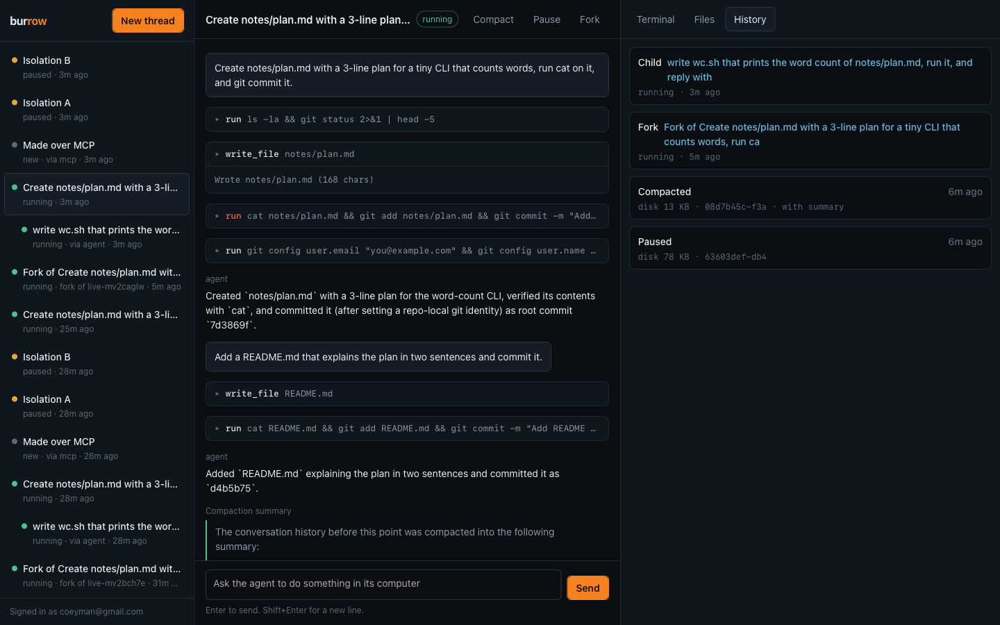
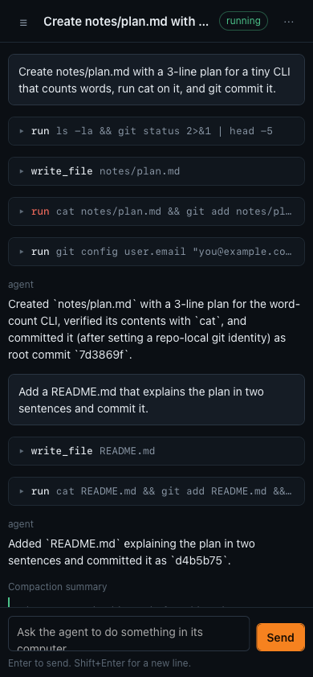
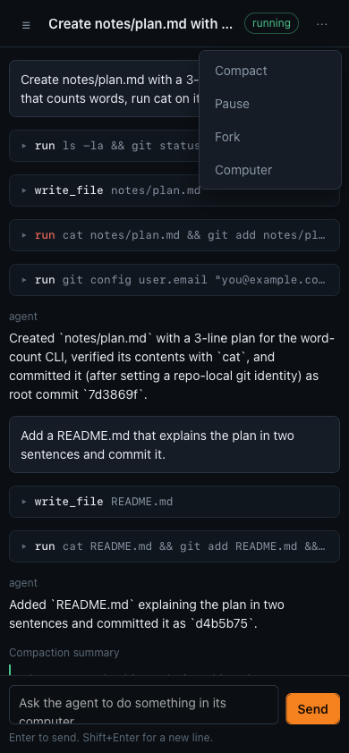

# coil

**One thread, one agent, one computer. On Cloudflare, compacted together.**



An agent that works on code needs two things that last: its conversation and its disk. Most setups keep them in two places. The chat is in a database, the files are in a VM or a shared volume, and nothing ties them together. Kill the process and the chat comes back without its files. Run two threads and they edit the same folder. Pause a thread and you pay for an idle machine, or you lose what was on it.

coil puts both in one [Durable Object](https://developers.cloudflare.com/durable-objects/) per thread:

- the agent is a [Pi Durable](https://earendil.com/posts/pi-durable/) harness on the object's SQLite;
- the computer is a [Cloudflare Container](https://developers.cloudflare.com/containers/) attached to the same object, driven through the [Sandbox SDK](https://developers.cloudflare.com/sandbox/), with its own git checkout in `/workspace`;
- the image is [nix-cf-proof](https://github.com/acoyfellow/nix-cf-proof)'s Nix build, so every computer has a patched git that cannot force-push;
- a small ledger in the same SQLite records each pause and each compaction as a **pair**: the transcript summary and the disk snapshot that match it.

```text
            Worker (Access-gated): web UI · HTTP API + SSE · MCP
                 │ getByName(thread)              │ getByName("all")
   ┌─────────────▼──────────────────────┐   ┌─────▼──────────────┐
   │ Thread Durable Object (per thread) │   │ Directory DO       │
   │                                    │──▶│ thread list, warm  │
   │ Pi Durable ── SQLite ── ledger     │   │ bases per repo     │
   │   │ run · write_file · read_file   │   └────────────────────┘
   │   │ start_child · wait_child       │
   │   ▼                                │
   │ ctx.container (nix image) /workspace
   │   pause:  snapshotContainer → destroy
   │   resume: start({ containerSnapshot })
   │   fork / child / warm: start from another snapshot
   └────────────────────────────────────┘
```

## What you can do

| | |
| --- | --- |
| **Start a thread** | Optional git repo. If a warm base exists for that repo, the computer starts from it instead of cloning. |
| **Watch it work** | Tool calls, their output, and the agent's replies stream into the page as they happen. Leave and come back; the turn keeps going. |
| **Terminals** | Open as many as you like with **+**. Each is a tmux session in the thread's computer, drawn by [cloudterm](https://github.com/acoyfellow/cloudterm). Close the tab or reload the page; the shell keeps running, and the next attach prints its history. |
| **Browser** | A real Chromium inside the same computer. It can open `localhost:3000` from a dev server the agent or you started. You click, type, and scroll on a live screencast; the agent drives the same page with browser tools. |
| **Files** | A file browser on the same `/workspace`. |
| **Pause** | The disk is saved and the computer is turned off. The next message, command, or file read resumes it. |
| **Compact** | The transcript is summarised and the disk is saved, recorded together. |
| **Fork** | A new thread starts from this thread's current disk and a summary of its conversation. |
| **Child threads** | The agent can hand a side task to a child thread with its own computer, then wait for its answer. |
| **Warm bases** | `POST /api/bases {repo, setup}` clones a repo, runs setup once, and snapshots it. |

The phone layout keeps the transcript and composer, with actions behind a menu:

 

## Run it

You need Bun, Docker (or colima), and a Cloudflare account with Containers (Workers Paid). The image is based on the nix-cf-proof image in your account's registry; change `NIX_IMAGE` in [`computer/Dockerfile`](computer/Dockerfile) to your own build.

```sh
git clone https://github.com/acoyfellow/coil && cd coil
bun install
bun run check                                     # typecheck, lint, offline tests in workerd
npx wrangler dev --var LOCAL_DEV_WITHOUT_ACCESS:1 # real containers in Docker, real Workers AI
```

Open `http://localhost:8787/`, or use the API:

```sh
curl -s -X POST localhost:8787/api/threads -H 'content-type: application/json' -d '{"name":"demo"}'
curl -s -X POST localhost:8787/api/threads/demo/messages \
  -H 'content-type: application/json' -H 'idempotency-key: turn-1' \
  -d '{"text":"Write hello.sh that prints hi, run it, and commit it.","wait":true}'
curl -sN localhost:8787/api/threads/demo/events          # live events while a turn runs
curl -s -X POST localhost:8787/api/threads/demo/pause    # save the disk, stop the computer
curl -s -X POST localhost:8787/api/threads/demo/fork     # new thread from this disk
```

## For agents

The same actions are tools on `POST /mcp` (JSON-RPC):

| Tool | Does |
| --- | --- |
| `thread_list` | All threads, newest activity first. |
| `thread_create` | New thread: its own agent and its own computer. Optional `repo`. |
| `thread_send` | One agent turn; returns the answer. The same `requestId` does not run the turn twice. |
| `thread_exec` | A shell command in the thread's `/workspace`. |
| `thread_read_file` | Read a file from the thread's computer. |
| `thread_compact` | Compact the transcript and snapshot the disk as one pair. |
| `thread_pause` | Snapshot the disk and stop the computer. |
| `thread_fork` | New thread from this thread's disk and a summary of its conversation. |
| `thread_status` | Phase, transcript, pairs, and recent commands. |
| `base_prepare` | Clone a repo, run setup once, snapshot it for warm starts. |

## How do I know it works?

`bun run check` runs 13 tests offline: four in workerd against the real `Thread` and `Directory` Durable Objects and the real Pi Durable harness, with a scripted model and an in-memory computer ([`test/worker/index.ts`](test/worker/index.ts)), and nine against the Access verifier ([`test/access.test.ts`](test/access.test.ts)).

| Test | Proves |
| --- | --- |
| Isolation | A file one thread's agent writes is not visible to another thread |
| Kill and resume | A thread killed with `ctx.abort()` mid-turn finishes the same request, once |
| Compaction pairs | Compact, pause, kill, resume: the disk and the summary come back together, and the recorded summary entry is the real one |
| Directory and fork | Threads made over MCP and the web are both listed; a fork reads the parent's file |
| Access | A missing, malformed, expired, wrong-issuer, wrong-audience, wrong-key, or unknown-key token is refused |

[`receipts/live-ui.json`](receipts/live-ui.json) is a run on the deployed Worker, behind Access, on Cloudflare Containers with the Nix image:

| Step | Result |
| --- | --- |
| Create | Patched git 2.55.0; a forced push is refused |
| Live stream | 18+ events reached the page before the turn finished |
| Pause, resume | The agent's file and commit were there after resume |
| Compact | A summary entry was recorded with the disk snapshot, and the agent kept working |
| Fork | The fork read the parent's file on a different machine |
| Child | The agent started a child thread and reported its answer |
| Warm start | A prepared base for this repo; a new thread started from it in about 1 s |
| Isolation | A file written in one thread's computer was absent in another's; different hosts |
| Thread list | A fresh browser listed threads made by the script and over MCP |

`scripts/gate.sh` fails unless all of that holds, the repo is pushed, and the URL redirects to Access.

## What it does not do

- **It does not restore running processes.** A resumed computer gets its disk back, not its memory. Terminal tabs reopen as new shells in the same folders, and the browser starts on a blank page.
- **It is not multi-user.** One owner per deploy, behind [Cloudflare Access](https://developers.cloudflare.com/cloudflare-one/policies/access/). The Worker verifies the Access token itself and returns 503 if Access is not configured.
- **It is not a security boundary for hostile code on its own.** Computers have internet access.
- **Replies arrive whole, not token by token.** The Workers AI bridge returns complete messages; tool calls and their output stream live.
- **`run` and `start_child` are `replay: "unsafe"`.** If a thread dies mid-command, Pi Durable does not run the command again.
- **There is no diff review view.** Use the terminal or the file browser.

## Why the browser runs in the computer

We measured three engines on the same page ([`receipts/browser-eval.json`](receipts/browser-eval.json)):

| Engine | Cold start | Screencast | Click | Opens the computer's `localhost` |
| --- | --- | --- | --- | --- |
| Chromium in the thread's computer | ~2 s | ~33 fps | ~46 ms | yes |
| Browser Run (Chromium) | 0.4–1.9 s | ~30 fps | 57–145 ms | no |
| Browser Run Kitesurf | ~0.6 s | ~23 fps | 88–146 ms | no |

Only the in-computer browser can open the dev server the agent just started, keeps its cookies for the life of the computer, and adds no second bill. Kitesurf is a good fit later for fast, stateless reads of public pages.

## Where to change behavior

| File | What |
| --- | --- |
| [`src/agent.ts`](src/agent.ts) | The prompt and the tools the agent gets |
| [`src/thread.ts`](src/thread.ts) | Lifecycle: boot, pause, compact, fork context, children, live events |
| [`src/service.ts`](src/service.ts) | Create, fork, and warm bases across threads |
| [`src/directory.ts`](src/directory.ts) | The thread list and warm bases |
| [`src/computer.ts`](src/computer.ts) | The Sandbox SDK computer: start, exec, files, snapshots |
| [`src/terminal.ts`](src/terminal.ts) | Terminals: tmux over a PTY WebSocket. Binary frames are keys; text frames are `{"resize":[cols,rows]}` |
| [`src/browser.ts`](src/browser.ts) | The browser: Chromium over `--remote-debugging-pipe` (NUL-separated JSON on exec stdio, no open port), screencast, input, and agent tools |
| [`scripts/build-term.mjs`](scripts/build-term.mjs) | Bundles cloudterm into `/assets/term-<hash>.js` |
| [`src/ui/`](src/ui) | The web UI |
| [`computer/Dockerfile`](computer/Dockerfile) | The image: nix-cf-proof (patched git), the sandbox shim, busybox, and tmux plus Chromium from Alpine |

## Prior art it builds on

- **[armada](https://github.com/AshishKumar4/armada)**: a prepared container can be snapshotted and started again in seconds. coil uses the same calls for pause, fork, children, and warm bases.
- **[tardigrade](https://github.com/acoyfellow/tardigrade)**: Pi Durable in a Durable Object comes back after `ctx.abort()`; the offline kill test shape.
- **[terrarium](https://github.com/acoyfellow/terrarium)**: one Durable Object as the source of truth for a run; output logged with a byte count and hash.
- **[nix-cf-proof](https://github.com/acoyfellow/nix-cf-proof)**: the image, and the git that cannot force-push.

## License

MIT
