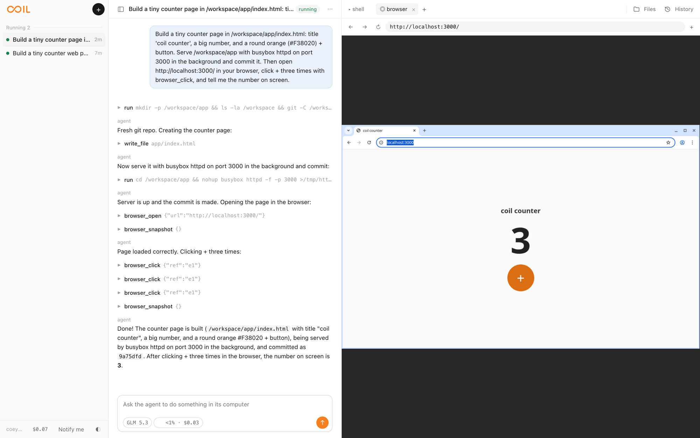
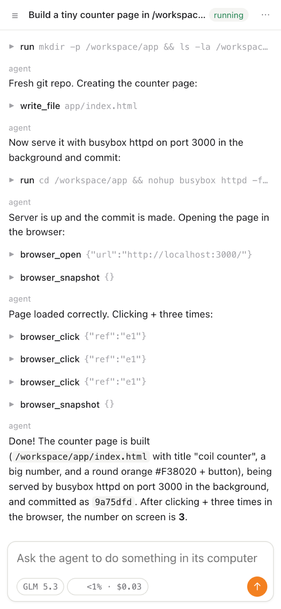

<p align="center">
  
</p>

<p align="center"><b>Agent threads with their own computer, in the cloud.</b><br>
Each thread gets terminals, a real Chrome window, and a disk. You and the agent use the same ones, from any device.</p>

<p align="center">
  <a href="#quick-start-for-agents">For agents</a> ·
  <a href="#deploy">Deploy</a> ·
  <a href="#what-you-get">What you get</a> ·
  <a href="#limits">Limits</a> ·
  <a href="#proof">Proof</a>
</p>

<picture>
  <source media="(prefers-color-scheme: dark)" srcset="docs/hero-dark-v6.png">
  
</picture>

<sub>One prompt. The agent wrote a page, served it on <code>localhost:3000</code>, opened it in the thread's own Chrome, clicked <b>+</b> three times, and read back <b>3</b>. <a href="docs/demo-counter.mp4">Watch the 8-second clip</a>.</sub>

coil is one Cloudflare Worker. Every thread is a [Durable Object](https://developers.cloudflare.com/durable-objects/) that runs a [Pi](https://github.com/earendil-works/pi) agent and owns a [Container](https://developers.cloudflare.com/containers/). It installs as a PWA. There is no desktop app, browser extension, or local helper.

An instance runs in one of two sign-in modes, set by `COIL_AUTH` in its config:

| Mode | Who gets in | Whose account runs Workers AI |
| --- | --- | --- |
| `access` (default) | Whoever your Zero Trust Access policy admits | The instance's account |
| `cloudflare` | Anyone who signs in with a Cloudflare account (OAuth) | The signed-in person's account |

Full guide and API reference: `/docs` on any instance. Plain text for agents: `/llms.txt`.

## Quick start for agents

Paste this to your coding agent:

```text
Deploy coil (https://github.com/acoyfellow/coil) to my Cloudflare account.
Read README.md "Deploy". Copy deploy/example.conf to deploy/<name>.conf,
ask me for the values you cannot look up, then run
`bun run ship -- deploy/<name>.conf`. It must finish with "coil is live".
Never commit deploy/<name>.conf.
```

Once it is deployed, an agent can drive coil without the UI. One list of capabilities ([`src/capabilities.ts`](src/capabilities.ts)) drives the MCP tools, the `coil_run` script tool, the REST endpoint, `/llms.txt`, and `/docs`.

| Surface | Use it for |
| --- | --- |
| `POST /mcp` | MCP. `coil_describe` returns a TypeScript declaration of the `coil` object. `coil_run` runs an async script that calls `coil.<capability>(input)`, at most 40 calls per run, with no network access of its own. Every capability is also its own tool. |
| `POST /api/capabilities/<name>` | One capability, with its input as a JSON body. |
| `POST /api/threads/:name/messages` | One turn. Send an `Idempotency-Key` header. `"wait": true` waits for the answer; otherwise it returns 202. |
| `GET /api/threads/:name/events` | Server-sent events while a turn runs. |
| `GET /llms.txt`, `GET /docs` | The capability list as text and as a web page. Both are public. |

The MCP tools, in the order the server lists them:

`coil_describe`, `coil_run`, `thread_list`, `thread_create`, `thread_send`, `thread_status`, `thread_fork`, `thread_exec`, `thread_read_file`, `thread_write_file`, `browser_open`, `browser_snapshot`, `browser_click`, `browser_type`, `browser_eval`, `thread_compact`, `thread_message`, `thread_wait`, `thread_context_budget`, `thread_model`, `thread_stop`, `thread_pause`, `thread_resize`, `thread_extensions`, `base_prepare`.

**Signing in from a script.** On an `access` instance, send a Cloudflare Access token in the `cf-access-token` header. Get one with `cloudflared access login https://<your-domain>`, then `cloudflared access token -app https://<your-domain>`. On a `cloudflare` instance there is no header token: calls need the signed session cookie from signing in at `/oauth/login`. Without it, `/api/*` and `/mcp` answer 401 with `{"error":"sign in with Cloudflare first"}`.

## What you get

| | |
| --- | --- |
| **A computer per thread** | `/workspace` is a git repo (or a clone of the repo you give). bash, git, node, python3, curl, ripgrep, jq. The image's git refuses force-push. |
| **Terminals** | As many as you want. Each is a tmux session the agent can use too. Reload the page and the shell is still there. |
| **A real browser** | Headed Chrome in the same computer, shown over VNC. It opens the agent's `localhost:3000`. Tabs, menus, and DevTools work. The agent drives the same window with browser tools; the panel follows it. Logins persist across pauses. |
| **Pause, fork, compact** | Pause saves the disk and stops the computer. Fork starts a new thread from this disk plus a summary. Compact records the summary and the disk together, so they always match. |
| **Child threads** | The agent can give a side task to a child thread with its own computer and wait for the answer. Threads can also message each other (`thread_message`, `thread_wait`). |
| **Pi extensions** | Load stock Pi extensions into a thread with `thread_extensions`, from an https git URL (optionally `#ref` or `#ref:subdir`) or a `./path` inside `/workspace`. Their tools run inside the thread's computer. The agent can call them from its next turn. |
| **Loops** | Run a prompt every 30 seconds or more, until a gate command exits 0, a run count or dollar limit is reached, or you stop it. |
| **Models** | Workers AI by default. Add an AI Gateway or any OpenAI/Anthropic-compatible gateway for frontier models. Pick per thread. |
| **Spend** | A per-person dollar limit, set from the sidebar. No limit by default. Each thread shows context used and dollars spent. |
| **Layout** | Collapse or resize the thread list (⌘B) and the computer (⌘J). ⌘K opens the command palette. Phones get drawers. |
| **Share** | A read-only link to a conversation at `/s/<token>`. The visitor must still be signed in. |
| **Private by owner** | Each signed-in person gets their own threads. Nobody can open anyone else's. |



## Deploy

One command per instance. Each instance has one config file that never leaves your machine.

**You need**

- Bun and Docker (builds `linux/amd64`).
- A Cloudflare account on Workers Paid with Containers and Workers AI, and `npx wrangler login`.
- A zone in that account for the hostname.
- The [nix-cf-proof](https://github.com/acoyfellow/nix-cf-proof) base image in that account's registry (`npx wrangler containers push`).
- For `COIL_AUTH=access`: a self-hosted Zero Trust **Access application** for exactly that hostname. Copy its **Application Audience (AUD)**.
- For `COIL_AUTH=cloudflare`: an OAuth client from **Manage Account → OAuth clients** with the redirect URL `https://<your-domain>/oauth/callback`, and no Access application on the host. Before you ship, store two Worker secrets on the instance account: `OAUTH_CLIENT_SECRET`, and `SESSION_SECRET` (at least 32 characters). [`deploy/example.conf`](deploy/example.conf) has the commands.

**Then**

```sh
git clone https://github.com/acoyfellow/coil && cd coil && bun install
cp deploy/example.conf deploy/mine.conf     # git ignores deploy/*.conf
$EDITOR deploy/mine.conf
bun run ship -- deploy/mine.conf
```

`ship` ([`scripts/ship.sh`](scripts/ship.sh)) does this, in order:

1. Checks the file has every value its mode needs.
2. Runs typecheck, lint, and tests.
3. Writes `wrangler.<name>.local.jsonc` with the image, and deploys to the account in the file.
4. If `COIL_MODEL_GATEWAY_TOKEN_COMMAND` is set, runs it and stores the output as the Worker secret `MODEL_GATEWAY_TOKEN`.
5. In `cloudflare` mode, stops if `OAUTH_CLIENT_SECRET` or `SESSION_SECRET` is missing.
6. Fails unless the host matches the mode: an Access login for `access`, no Access login for `cloudflare`.

If `COIL_AUTH` is neither mode, the Worker answers 503. `bun run ship:all -- deploy/<a>.conf deploy/<b>.conf` ships several instances in parallel.

**Public and private instances.** The repo holds the engine and `deploy/example.conf`. Your real instances live in `deploy/<name>.conf` files that git ignores: account ID, hostname, sign-in settings, image, and gateway settings. Keep several side by side (for example a personal one and a team one) and ship each with its own file. Nothing private is committed, and `bun run check` fails if an account ID or token appears in a tracked file.

**Models** (all optional, in the same file)

| Setting | Effect |
| --- | --- |
| `COIL_MODEL` | Default Workers AI model. Default `@cf/zai-org/glm-5.3`. |
| `COIL_AI_GATEWAY` | An AI Gateway in the same account. Enables the `gateway/*` models through the AI binding, billed to that account. |
| `COIL_MODEL_GATEWAY_URL`, `COIL_MODEL_GATEWAY_HEADER`, `COIL_MODEL_GATEWAY_TOKEN_COMMAND` | Any gateway that serves `<url>/openai` and `<url>/anthropic`. The token command runs on your machine at deploy time; its output becomes a Worker secret. |

### Run locally

```sh
NIX_IMAGE=<image> node scripts/with-image.mjs
npx wrangler dev -c wrangler.local.jsonc --var LOCAL_DEV_WITHOUT_ACCESS:1
```

Real containers in Docker and real Workers AI. Open `http://localhost:8787/`. `LOCAL_DEV_WITHOUT_ACCESS` skips sign-in only for `localhost`, `127.0.0.1`, and `[::1]`.

## Limits

- **Passkeys and security keys do not work in the cloud browser.** The key is on your device; WebAuthn only signs for the page's own site. Password + TOTP logins work and stay logged in.
- **Idle threads pause after 9 minutes** with no turn, command, or open terminal or browser. The next action resumes them.
- **A resumed computer gets its disk back, not its processes.** Terminals reopen in the same folders. Servers the agent started are gone until something starts them again.
- **The browser comes back on its last page, not its state.** After a restart, Chrome reopens the last `http`, `https`, or `file` URL it had open, with its cookies. The page reloads, so anything held only in the page (a counter, a form) starts over.
- **The browser view is 1280×800, scaled to fit.**
- **Agent commands stop after 120 seconds.** Start servers in the background. API and MCP commands stop after 10 minutes. Output is cut at 256 KB.
- **A Pi extension tool call stops after about 280 seconds.** Only tools load. Extension commands and shortcuts are reported as unsupported.
- **The model gateway token is minted once per deploy.** `ship` runs `COIL_MODEL_GATEWAY_TOKEN_COMMAND` on every run. If that token expires, `gateway/*` turns fail until you run `bun run ship -- deploy/<name>.conf` again. The chat shows `The model call failed:` and then the gateway's response; coil has no message of its own for an expired token.
- **`cloudflare` mode sessions last 30 days.** coil refreshes the account token before each call. If the grant is revoked, turns fail with "Sign in with Cloudflare again".
- **Computers have internet access.** coil is not a sandbox for hostile code.
- **Snapshots are kept.** The container binding has no delete call yet.
- **Notifications need an open tab.** No Web Push yet.
- **No splits yet.** The computer panel is one row of tabs.

## Proof

`bun run check` runs the offline suite in workerd: the real `Thread` and `Directory` Durable Objects and the real Pi harness, with a scripted model and an in-memory computer.

| Test | Proves |
| --- | --- |
| Isolation | One thread's files are not visible to another |
| Kill and resume | A thread killed mid-turn finishes the same request once |
| Compaction pairs | After compact, pause, kill, resume, the disk and summary come back together |
| Access | Missing, expired, wrong-issuer, wrong-audience, or wrong-key tokens are refused |
| Browser restore | After the Durable Object is killed, the thread still has the last real page URL |
| Owners | A second user cannot list, read, run, pause, or fork your threads |
| Spend | A person over their limit cannot start turns or children |
| Gateways | Gateway models route to the right path and never send a provider key |

| Receipt | Shows |
| --- | --- |
| [`receipts/f1-agent-path.json`](receipts/f1-agent-path.json) | On coil.coey.dev: `/llms.txt` and `/docs` served. MCP lists `coil_run` and `coil_describe`. A `coil_run` script ran a shell command, clicked in the browser twice, and paused |
| [`receipts/f2-pi-extensions.json`](receipts/f2-pi-extensions.json) | On coil.coey.dev: two stock Pi extensions loaded with no errors, and the agent called both tools inside the computer |
| [`receipts/auth-cloudflare.json`](receipts/auth-cloudflare.json) | On coil.coey.dev in `cloudflare` mode: an anonymous request was refused. A signed-in user created a thread, switched to `gateway/claude-opus-5-5`, and got an answer |
| [`receipts/live-v5.json`](receipts/live-v5.json) | Production run: loops, share links, notifications, edit and retry, palette, phone layout, agent tools |
| [`receipts/lighthouse-v5.json`](receipts/lighthouse-v5.json) | Lighthouse 99 / 100 / 100 / 100 |
| [`receipts/flow-control.json`](receipts/flow-control.json) | Terminal output stops for a client that stops acknowledging |
| [`receipts/browser-eval.json`](receipts/browser-eval.json) | Why the browser runs inside the computer |
| [`receipts/reviews/`](receipts/reviews) | Independent adversarial reviews, every round kept |
| [`docs/research/remote-webauthn.md`](docs/research/remote-webauthn.md) | What can and cannot work for security keys from a PWA |

## Where things live

| Path | What |
| --- | --- |
| [`src/agent.ts`](src/agent.ts) | The prompt and the agent's tools |
| [`src/capabilities.ts`](src/capabilities.ts) | The capability list behind MCP, `coil_run`, REST, `/llms.txt`, and `/docs` |
| [`src/auth/`](src/auth) | `access` and `cloudflare` sign-in |
| [`src/extensions.ts`](src/extensions.ts), [`computer/pi-host.mjs`](computer/pi-host.mjs) | Pi extensions: sources, and the host that runs them in the computer |
| [`src/thread.ts`](src/thread.ts) | One thread: boot, pause, compact, fork, children, loops, live events |
| [`src/gateway.ts`](src/gateway.ts) | Model routing: Workers AI, AI Gateway, external gateways |
| [`src/browser.ts`](src/browser.ts) | Xvfb, x11vnc, and Chrome over a CDP pipe |
| [`src/terminal.ts`](src/terminal.ts) | tmux over a PTY WebSocket with flow control |
| [`client/src/`](client/src) | The web client ([foldkit](https://github.com/foldkit/foldkit) on [Effect](https://effect.website)) |
| [`computer/Dockerfile`](computer/Dockerfile) | The computer image |
| [`scripts/ship.sh`](scripts/ship.sh), [`deploy/example.conf`](deploy/example.conf) | Deploy |

## Built on

[Pi](https://github.com/earendil-works/pi) · [armada](https://github.com/AshishKumar4/armada) (snapshot and restart) · [tardigrade](https://github.com/acoyfellow/tardigrade) · [cloudterm](https://github.com/acoyfellow/cloudterm) · [noVNC](https://github.com/novnc/noVNC) · [nix-cf-proof](https://github.com/acoyfellow/nix-cf-proof)

## License

MIT
